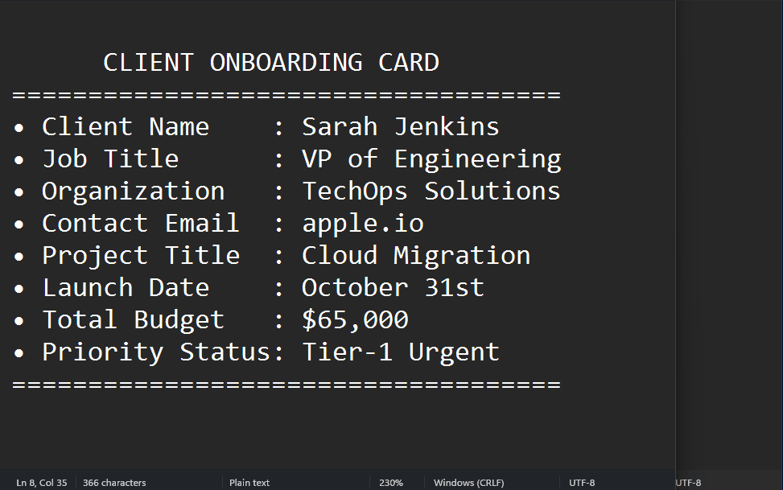

<div align="center">


# QPaste

**Copy continuously. Paste sequentially.**

A clipboard queue for Windows. Copy several things in a row, then paste them back in the same order, without switching windows for every item.

[](https://github.com/chinthanasathyajithcs/qpaste)
[](https://www.python.org/)
[](https://github.com/chinthanasathyajithcs/qpaste/releases/latest)
[](https://github.com/chinthanasathyajithcs/qpaste/releases)
[](src/tests)
[](LICENSE)

[**Download**](https://github.com/chinthanasathyajithcs/qpaste/releases/latest) &nbsp;·&nbsp; [**What's New**](#whats-new-in-v120) &nbsp;·&nbsp; [**Report a Bug**](https://github.com/chinthanasathyajithcs/qpaste/issues)

<br />

<!-- launch-video -->


Free &nbsp;·&nbsp; No account &nbsp;·&nbsp; Works offline &nbsp;·&nbsp; Open source

</div>

---

## Why QPaste

The Windows clipboard holds one item at a time. Filling in a form from a chat, an email and a spreadsheet means copying one value, switching to the form, pasting, switching back, and doing it all again for every field.

QPaste adds a first-in, first-out queue on top of the clipboard. Turn on Queue Mode, copy everything you need in one pass, then paste it all in one pass. Each `Ctrl+V` pastes the oldest item still in the queue.

## How It Works

1. **Press `F4`** to turn on Queue Mode. A small toast confirms `QPaste : ON`.
2. **Copy as usual** with `Ctrl+C`, from any app. Each copy joins the back of the queue, and a counter shows how many items are waiting.
3. **Paste in order** with `Ctrl+V`. Items come out in the order you copied them, and the counter rolls down as you go.

When the queue is empty, or Queue Mode is off, `Ctrl+V` behaves exactly like normal Windows paste. QPaste lives in the system tray and never takes focus away from the window you are working in.

---

## What's New in v1.2.0

### Works on any keyboard layout
Queue paste and custom hotkeys now match keys by their physical position, not by the character they type. They work the same on Russian, French (AZERTY), German (QWERTZ) and other non-US layouts. Settings also warns you when a `Ctrl+Alt` combo could clash with AltGr typing on layouts such as German or Polish.

### Assign any key combo
Click **Record** next to a shortcut in Settings and press the keys you want. The combo shows up as key caps while you press it, and it is saved only once it is complete and valid. Reserved combos (`Ctrl+C`, `Ctrl+V`, `Alt+F4`, `Alt+Tab`, ...), duplicates and bare letters are rejected with a clear message. The new shortcut works immediately, with no restart.

### Animated queue counter
The count toast now rolls up as you copy and down as you paste, so you always know how many items are left.

### Quick Notepad improvements
Resize the notepad from its corner grip, zoom the text with `Ctrl` + `+` / `-` / `0` or `Ctrl` + mouse wheel, and enjoy a scrollbar that matches the dark theme. Size and zoom are remembered between sessions.

<details>
<summary><b>Earlier releases</b></summary>

#### v1.1.0
- **Customizable hotkeys:** remap `F4`, `Shift+F4` and `F3` from the Settings tab. Changes apply live.
- **Quick Notepad (`F3`):** a frameless, dark scratchpad that floats over any window. It saves on every keystroke, persists across reboots and closes with `Esc`.
- **Office copy debounce:** a 200 ms filter removes duplicate items when copying formatted text in Word and Excel.
- **Activity-based auto-clear:** the queue only expires after real inactivity, never while you are copying or pasting.
- **Settings tab:** hotkeys, auto-clear options and a one-click reset to defaults.

</details>

---

## Features

| Feature | Details |
|---|---|
| **Sequential queue** | Thread-safe FIFO queue that holds up to 25 copied items |
| **Count toast** | A small overlay shows the queue status and count without stealing focus |
| **Quick Notepad** | Floating scratchpad on `F3`, with zoom, resize and auto-save |
| **Queue Inspector** | Review queued items, delete one, or clear them all |
| **Custom shortcuts** | Record your own key combos for every action |
| **Any keyboard layout** | Works the same on non-US layouts |
| **Auto-clear** | Optionally empty the queue after a period of inactivity |
| **Start with Windows** | Optional silent start on boot |
| **Single instance** | A named mutex prevents duplicate copies from fighting over hotkeys |
| **Clipboard lock handling** | Automatic retries when another app is holding the clipboard |
| **Private by design** | Everything runs locally. No account, no network access |

## Keyboard Shortcuts

| Shortcut | Action | Customizable |
|---|---|:---:|
| `F4` | Turn Queue Mode on or off | Yes |
| `Shift + F4` | Clear the queue | Yes |
| `F3` | Show or hide the Quick Notepad | Yes |
| `Ctrl + C` | Copy (added to the queue while Queue Mode is on) | No |
| `Ctrl + V` | Paste the next queued item (normal paste when the queue is empty) | No |

To change a shortcut, open the Queue Inspector from the tray icon, go to **Settings**, click **Record** on a row and press your combo. `Esc` cancels, the reset button restores that row, and **Reset Defaults** restores them all.

---

## Installation

Download from the [latest release](https://github.com/chinthanasathyajithcs/qpaste/releases/latest):

- **`QPaste_Setup_v1.2.0.exe`** (recommended): installs to `%LocalAppData%\Programs\QPaste` with Start Menu shortcuts, an optional start-with-Windows setting and an uninstaller.
- **`QPaste.exe`**: a portable single executable. No installation needed.

Requires Windows 10 or 11.

## Building from Source

**Prerequisites:** Python 3.11+, Windows 10/11, plus PyInstaller and Inno Setup 6 if you want to build the executable and installer.

```powershell
git clone https://github.com/chinthanasathyajithcs/qpaste.git
cd qpaste

python -m venv src\.venv
.\src\.venv\Scripts\Activate.ps1
pip install -r src\requirements.txt

# Run the app
python src\main.py

# Run the test suite
python -m pytest
```

```powershell
# Portable executable -> dist\QPaste.exe
python -m PyInstaller qpaste.spec

# Installer -> installer\Output\QPaste_Setup_v1.2.0.exe
ISCC.exe installer\qpaste_setup.iss
```

## Project Structure

```
qpaste/
├── assets/                  App icon and demo media
├── docs/                    Product requirements
├── installer/               Inno Setup script
├── src/
│   ├── core/
│   │   ├── clipboard_queue.py   Thread-safe FIFO queue with idle tracking
│   │   ├── config.py            Persistent JSON settings
│   │   ├── hotkey_parser.py     Hotkey parsing and layout-independent matching
│   │   ├── hotkey_rules.py      Hotkey validation (reserved, duplicate and AltGr rules)
│   │   ├── listener.py          Keyboard hooks, debounce and clipboard listener
│   │   ├── single_instance.py   Win32 named mutex
│   │   ├── startup.py           Start-with-Windows registry entry
│   │   └── state.py             Queue Mode state
│   ├── ui/
│   │   ├── dark_scrollbar.py    Scrollbar that matches the dark theme
│   │   ├── hotkey_recorder.py   Press-to-record shortcut field
│   │   ├── inspector.py         Queue Inspector window
│   │   ├── notepad.py           Quick Notepad overlay
│   │   ├── settings_tab.py      Hotkey and auto-clear settings
│   │   └── toast.py             Focus-free toast overlay
│   ├── tests/                   332 unit and integration tests
│   └── main.py                  Entry point and tray icon
└── qpaste.spec              PyInstaller build spec
```

## Contributing

Bug reports and pull requests are welcome. Issues labelled [good first issue](https://github.com/chinthanasathyajithcs/qpaste/labels/good%20first%20issue) are a good place to start. If you use a non-US keyboard layout, reports on how QPaste behaves with it are especially helpful.

## License

[MIT](LICENSE) © 2026 ChinthanaSathyajith

<div align="center">
<br />
<sub>If QPaste saves you some tab-switching, consider giving it a star.</sub>
</div>
